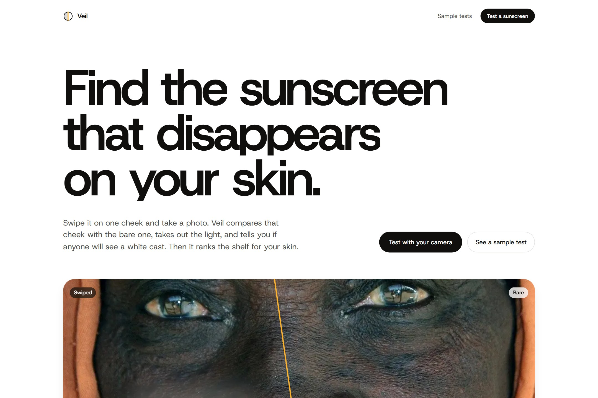
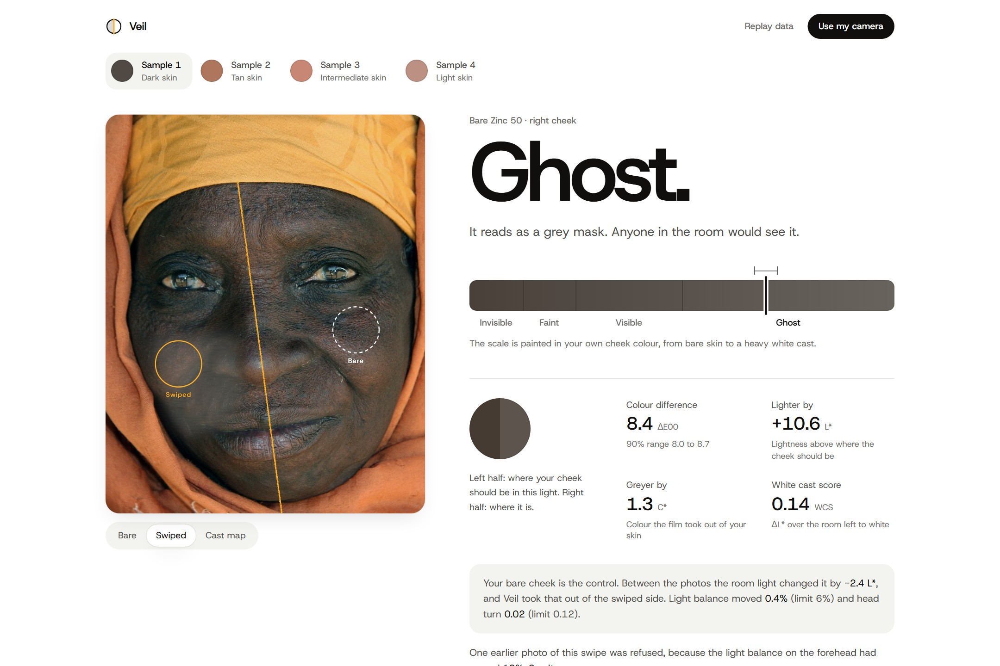
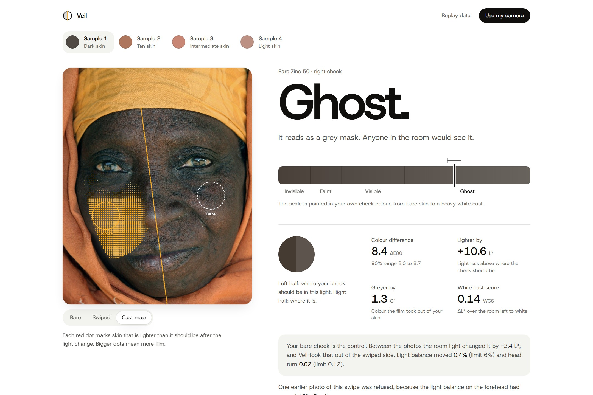
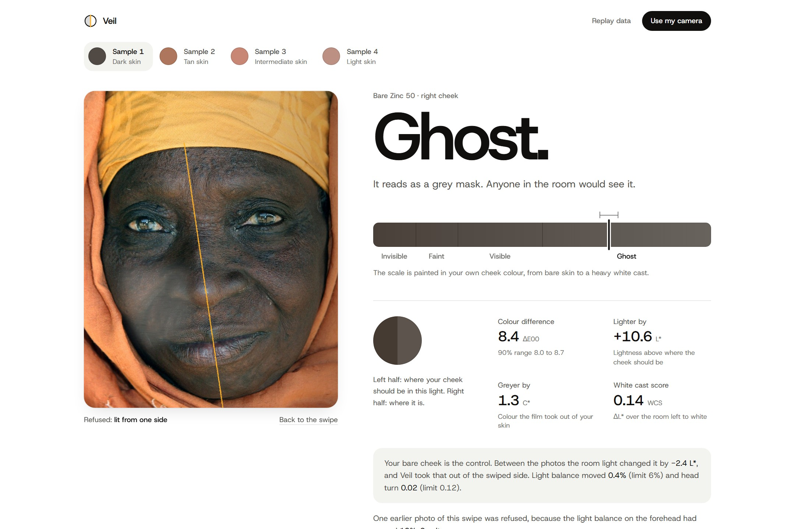
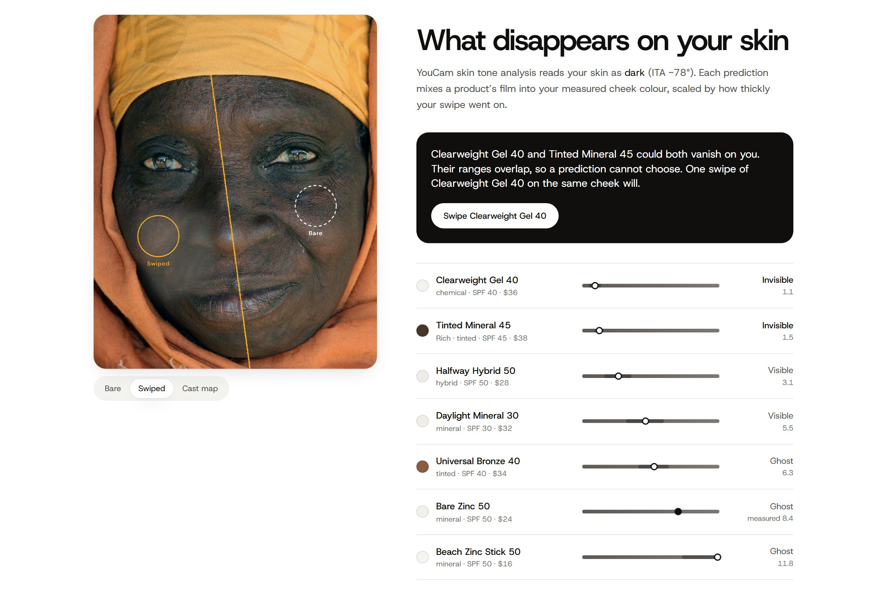
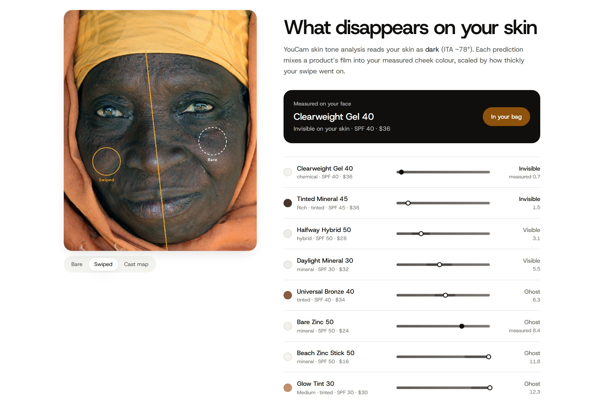
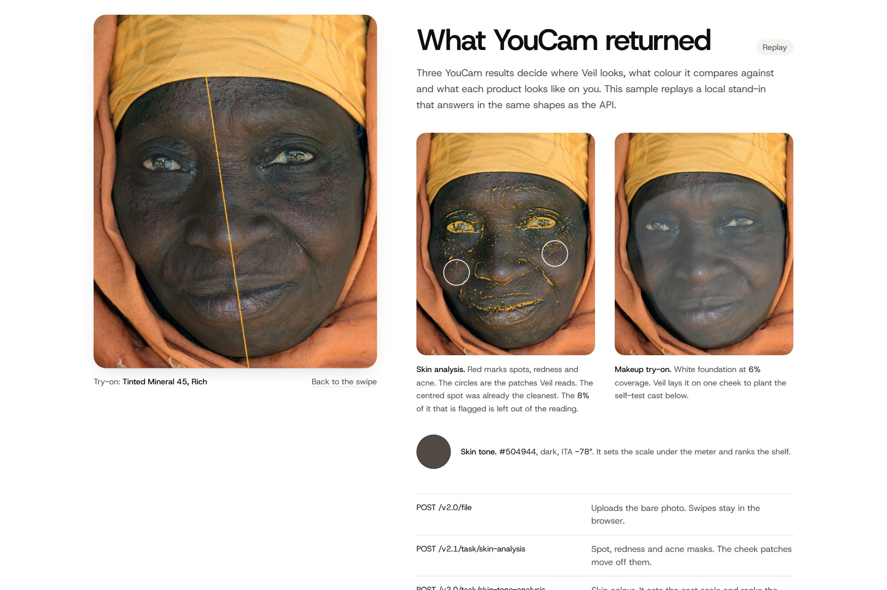
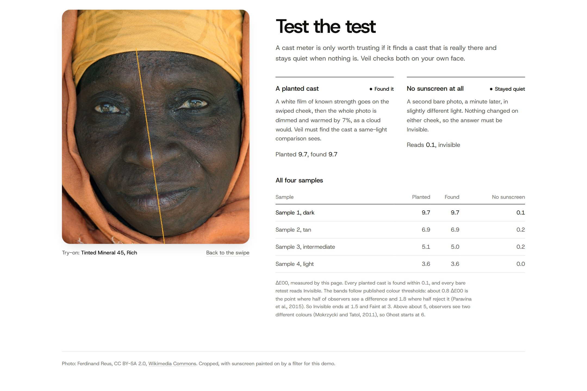

# Veil

**Find the sunscreen that disappears on your skin.**

Veil tests a sunscreen for white cast on your own face. You take a bare photo, swipe the sunscreen on one cheek, and take a second photo. The bare cheek is the control: it shares the light, the camera and the skin, so Veil can take the room out of the reading and report only the cast. Then it ranks a whole shelf of sunscreens for your skin, and asks for one more swipe when two products could both vanish.

Built on the YouCam API for the [YouCam API Skin AI & eCommerce VTO Hackathon](https://youcam-api-skin-ai-ecommerce.devpost.com/).



- **Live:** https://veil-skin.vercel.app
- **Sample tests (no key, no camera):** https://veil-skin.vercel.app/lab
- **Camera flow:** https://veil-skin.vercel.app/lab/live
- **Launch film (36 s):** [`launch/film/renders/final.mp4`](launch/film/renders/final.mp4)
- **Demo video (2:44):** [`submission/veil-demo.mp4`](submission/veil-demo.mp4)

## Why

White cast stops people with brown and Black skin from using sunscreen. In a 2024 survey in the *Journal of Drugs in Dermatology*, 25% of skin-of-colour patients named white cast as a reason they struggle with sunscreen, against 7% of white patients. 41% did not know how to find a product that suits them.

A shopper tests a sunscreen on the back of a hand, in shop light. A product page cannot help, because a cast depends on skin colour, light and how thickly you apply. So shoppers buy, see the cast at home, and return the product or stop wearing sunscreen.

Dermatology studies test a product on half of the face and keep the other half as the control. Veil puts that design in a phone and answers one question: **will anyone see this on me?**

## What it does

| | |
| --- | --- |
|  | **1. The reading.** Invisible, Faint, Visible or Ghost, with the colour difference in ΔE00 and its 90% range. The meter is painted in your own skin colour. |
|  | **2. The cast map.** Where the film sits on your cheek, tile by tile. |
|  | **3. The light gate.** If the light or your head moved since the bare photo, Veil refuses the photo and says why, instead of reporting a wrong cast. |
|  | **4. The shelf.** Every product is predicted on your measured skin, scaled to how thickly you applied. When two products could both vanish, an agent picks the one swipe that settles it. |
|  | **5. Try-on and buy.** YouCam makeup try-on shows any product on your whole face, next to Add to bag. |
|  | **6. What YouCam returned.** Every YouCam result is on screen with the decision it drives, plus the calls and their unit cost. |
|  | **7. Test the test.** Veil plants a white film of known strength with YouCam try-on, dims and warms the photo as a cloud would, and must find the film. A second bare photo must read Invisible. |

Your shelf stays in `localStorage`, so the next time you shop, Veil remembers what vanished on you.

## YouCam APIs

| Step | Endpoint | What Veil does with the result | Units |
| --- | --- | --- | --- |
| Upload | `POST /s2s/v2.0/file`, then `PUT` to the signed URL | Uploads the bare photo once. Swipes stay in the browser. | 0 |
| Skin analysis | `POST /s2s/v2.1/task/skin-analysis`, poll `GET …/{task_id}` | Masks for spots, redness and acne. The cheek patches move off them, and flagged pixels leave the reading. Without the masks, a red patch reads as a colour change. | 9 |
| Skin tone | `POST /s2s/v2.0/task/skin-tone-analysis`, poll | Skin colour and ITA depth. Sets the meter scale and ranks the shelf. | 20 |
| Makeup try-on | `POST /s2s/v2.0/task/makeup-vto` (foundation, smoothing off), poll | Shows a product on the whole face, and plants the known film for the self-test. | 1 each |

A shopper pays 29 units for the bare analysis and 1 unit per try-on. Swipes are measured in the browser for free. The API key stays on the server, and Veil stores no photos.

## How the measurement works

- **Alignment.** MediaPipe Face Landmarker gives a first fit of the two photos. Landmarks alone were off by about 25 px, because a white film on one cheek pulls the face mesh. Veil then matches skin texture at both brows and the nose bridge (normalised cross-correlation, which ignores light changes) and solves the alignment from those three points, to within one or two pixels.
- **Tiles.** Each cheek gets a 5 × 5 patch of tiles placed to avoid YouCam-flagged pixels. A tile counts only when both photos have it.
- **Light correction.** Multiplicative, in linear RGB: the bare cheek's change between photos predicts where the swiped cheek should be. The cast is the CIEDE2000 distance from that prediction to the measured colour.
- **Uncertainty.** A paired bootstrap over tiles gives the 90% range. A reading is "Unclear" only when the range is wide and its ends disagree on the verdict.
- **Shelf model.** Each product's film is mixed into your skin in linear light. Its strength comes from your measured swipe, so a heavy hand moves every prediction.
- **Verdict bands.** From published colour thresholds: half of observers see a difference at about 0.8 ΔE00 and half reject it at 1.8 (Paravina et al., 2015), so Invisible ends at 1.5 and Faint at 3. Above about 5, observers see two different colours (Mokrzycki and Tatol, 2011), so Ghost starts at 6.

## Validation

The planted cast and the bare retest run on all four samples:

| Sample | Skin | Planted (ΔE00) | Found | No sunscreen |
| --- | --- | --- | --- | --- |
| 1 | Dark | 9.7 | 9.7 | 0.1 |
| 2 | Tan | 6.9 | 6.9 | 0.2 |
| 3 | Intermediate | 5.1 | 5.0 | 0.2 |
| 4 | Light | 3.6 | 3.6 | 0.0 |

Every planted cast is found within 0.1, and every bare retest reads Invisible. The side-lit photo is refused on all four samples (11% to 14% light shift, limit 6%). The CIEDE2000 code passes the Sharma, Wu and Dalal reference pairs (`npm test`).

### Honest limits

- The four samples are licensed portraits. The sunscreen on them is painted by a filter, not real sunscreen.
- In the sample tests, a local stand-in answers in the same shapes as the YouCam API, and the panel says "Replay". With a key, `npm run capture` replaces it with recorded YouCam responses and the panel says "Recorded". The camera flow always calls the real API.
- Validation on real swipes across the Fitzpatrick range, against a panel asked "can you see it?", is the next step.

## Run it

Requires Node 20 or later.

```bash
npm install
npm run dev
```

Open http://localhost:3000. The sample tests in `/lab` work without a key.

For the camera flow, put your YouCam key in `.env.local` and restart:

```bash
YOUCAM_API_KEY=your-key
```

Then open `/lab/live` on a phone or a laptop with a camera.

### Test the live path without spending units

`scripts/mock-youcam.mjs` follows the documented file and task flow and answers with replay data:

```bash
node scripts/mock-youcam.mjs elder
YOUCAM_API_KEY=mock YOUCAM_API_HOST=http://localhost:4010/s2s npm run dev
```

Upload `public/replay/elder/bare.jpg`, then `swiped.jpg`. `retake.jpg` is lit from the side and must be refused.

### Commands

```bash
npm test          # colour, cast and shelf tests
npm run lint
npm run build
npm run fixtures  # rebuild replay data (Python 3 with numpy, scipy, Pillow)
npm run capture   # replace the stand-in masks, tone and try-on with real YouCam responses (needs YOUCAM_API_KEY, about 30 units per sample)
```

### Deploy

The app deploys to Vercel as is. Set `YOUCAM_API_KEY` in the project's environment variables.

## Code map

| Path | What it holds |
| --- | --- |
| `src/lib/color.ts` | Colour science: sRGB, linear light, CIELAB, CIEDE2000, ITA |
| `src/lib/measure.ts` | Landmarks, texture alignment, tiles, the light gate and the cast map |
| `src/lib/cast.ts` | ΔE00 reading, verdict bands and the bootstrap range |
| `src/lib/shelf.ts` | Shelf predictions and the next-swipe agent |
| `src/lib/veil.ts` | The test flow and the planted self-test |
| `src/lib/youcam.ts` | YouCam API client (server only) |
| `src/app/api/*` | Server routes: analyze, render, status and a signed image proxy |
| `src/app/lab` | Sample tests and the report |
| `src/app/lab/live` | Camera flow with the live viewfinder |
| `scripts/` | Fixture builder, YouCam capture and the mock server |
| `launch/film` | The launch film, a HyperFrames composition |

## Built with

Next.js 16, React 19, TypeScript, Tailwind CSS 4, MediaPipe Face Landmarker, GSAP, Lenis, Vercel and the YouCam API. The launch film is made with HyperFrames.

## Launch film

`launch/film` is a HyperFrames composition. From that folder:

```bash
npx hyperframes@0.8.186 render -o renders/final.mp4
```

The score is generated with MusicGen (facebook/musicgen-small). Sound effects come from [earshot](https://github.com/Leonxlnx/earshot). The type is Host Grotesk.

## Credits

Sample photos, cropped and processed:

- Ferdinand Reus, [Elderly Gambian woman face portrait](https://commons.wikimedia.org/wiki/File:Elderly_Gambian_woman_face_portrait.jpg), [CC BY-SA 2.0](https://creativecommons.org/licenses/by-sa/2.0/). The processed versions in `public/replay/elder` are shared under the same license.
- Alberto Buscató Vázquez, [Indian woman portrait](https://commons.wikimedia.org/wiki/File:Indian_woman_portrait.jpg), [CC BY-SA 4.0](https://creativecommons.org/licenses/by-sa/4.0/). The processed versions in `public/replay/market` are shared under the same license.
- Heath Cajandig, [Blonde close up](https://commons.wikimedia.org/wiki/File:Blonde_close_up_(34768208633).jpg), [CC BY 2.0](https://creativecommons.org/licenses/by/2.0/).
- Christopher Harris, [Smith Mountain Lake redhead](https://commons.wikimedia.org/wiki/File:Smith_Mountain_Lake_redhead_(Unsplash).jpg), CC0.

Film footage from Pexels under the Pexels license: clips 5891044, 7198952, 7614213, 7198957, 12322718 and 7298140. The full list with links is in [SUBMISSION.md](SUBMISSION.md).

The products in the app are a sample shop. Veil is not medical advice. Any sunscreen protects only when you apply enough of it.

## License

Code: [MIT](LICENSE). The sample photos keep their own licenses, listed above.
